<div>
<h3 align="center">Job Portal</h3>
    <div align="center">
        
        
        
        
        
        
        
    </div>
</div>

# Introduction

A React project for managing job applications, built with Node.js, Tanstack Query, React Redux and Axios.

The app provides login/register and logout funcitonality for users and companies, seperately. It lists available jobs for users with filters option and shows user applications. For companies, it contains add a new job, manage jobs and view applicants sections.

[Visit the application](https://job-portal-client-eta-one.vercel.app/).

# Tech Stack

- **React** – Core library
- **React Router Dom** – Declarative routing
- **TanStack Query** – Data fetching and caching
- **Axios** - Promise based HTTP client
- **Vite** – Fast build tool
- **TailwindCSS** – Styling and utilities
- **GitHub & Vercel** – Deployment

The project follows a layered architecture with separate pages, components, services, hooks, and config, providing a maintainable and scalable structure.

## Quick Start

**Cloning the Repository**

```bash
git clone https://github.com/aysegules/job-portal.git
cd client
```

**Installation**

Install the project dependencies using npm:

```bash
npm install
```

**Set Up Environment Variables**

Create a new file named `.env` in the root of your project and add the following content:

```env
VITE_BASE_URL="http://localhost:5000/api/v1"
```

**Start the App**

```bash
npm run dev
```

## Screenshots

#### User Login and Register

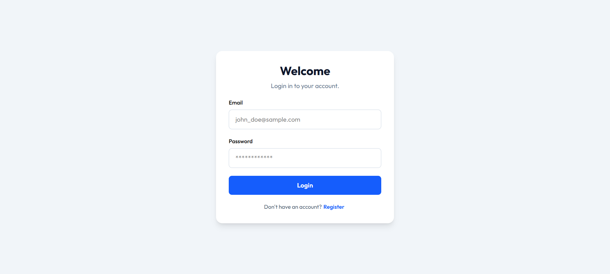

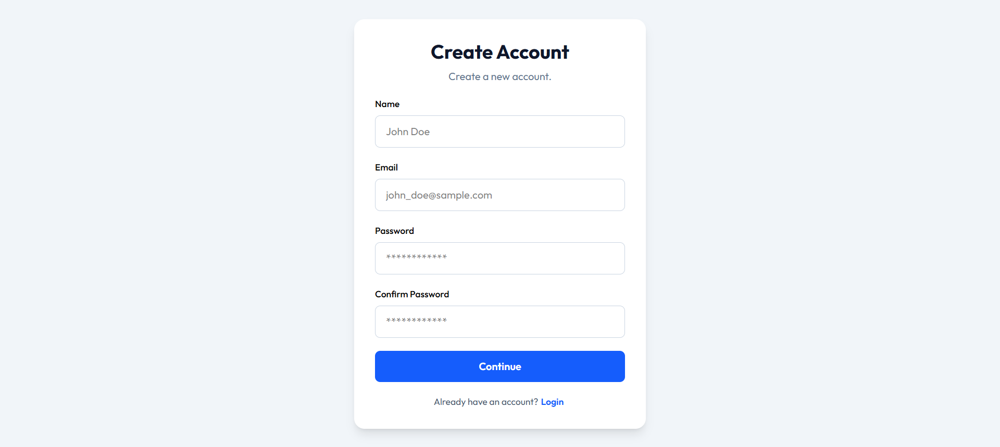

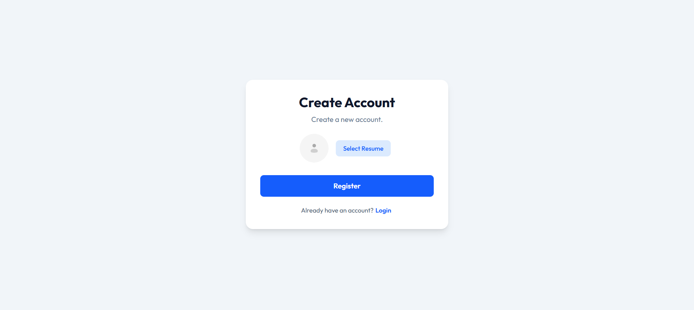

#### Home

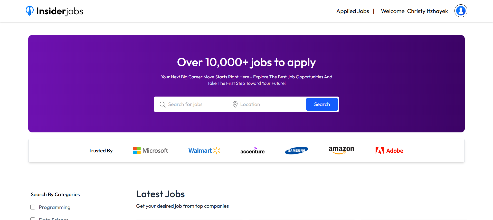

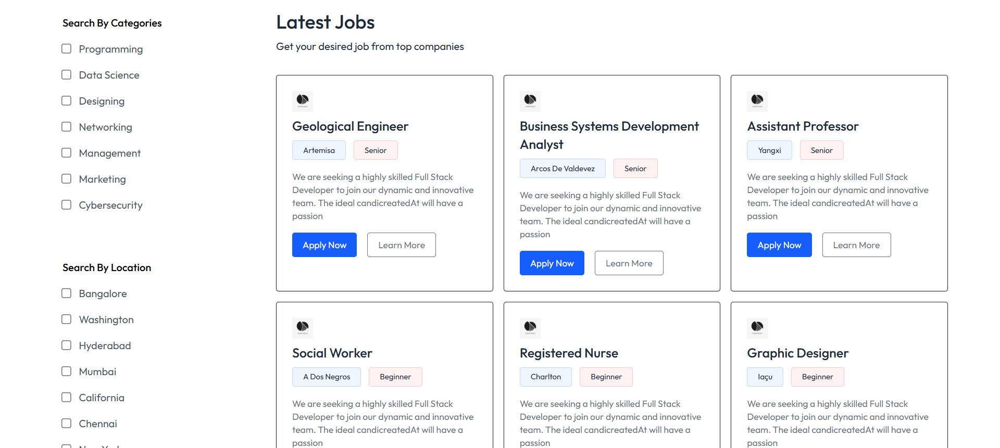


#### Apply Job

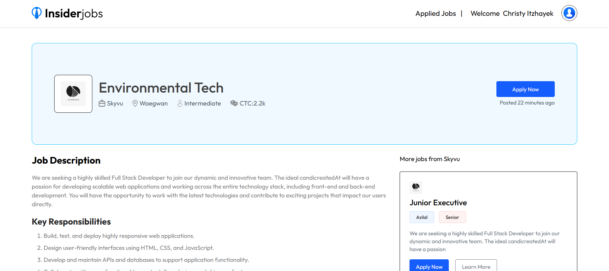

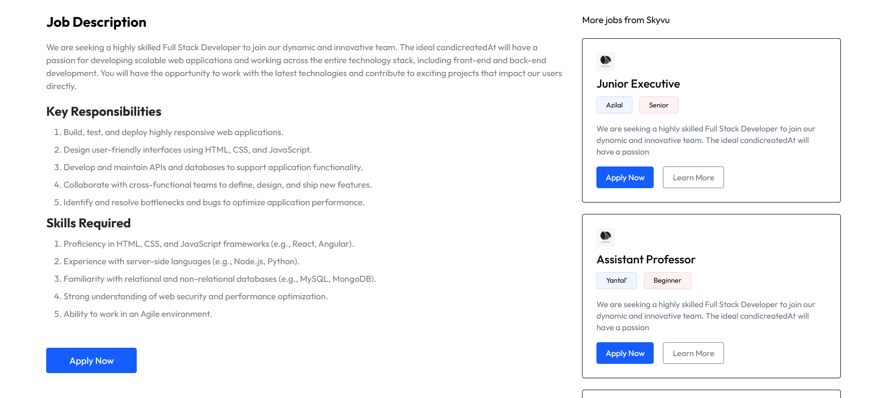

#### Applied Jobs

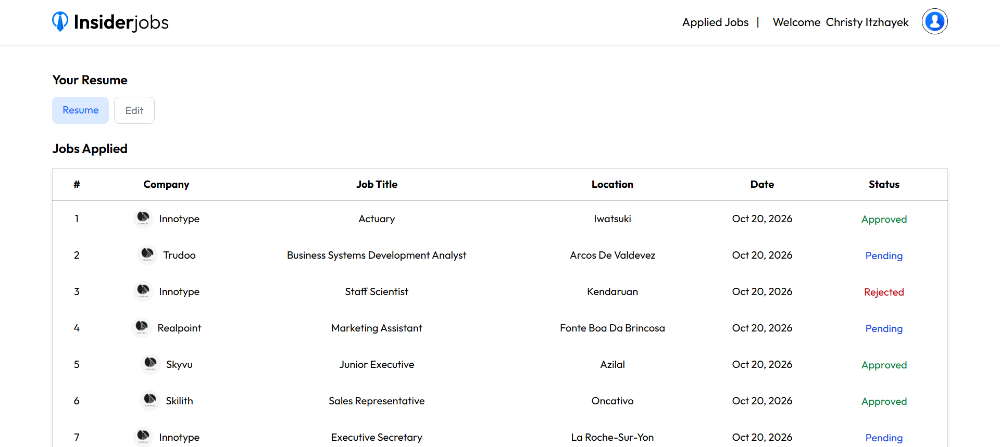

#### Company Login and Register

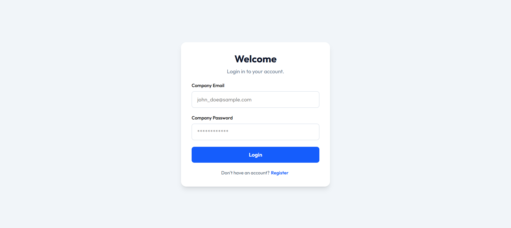

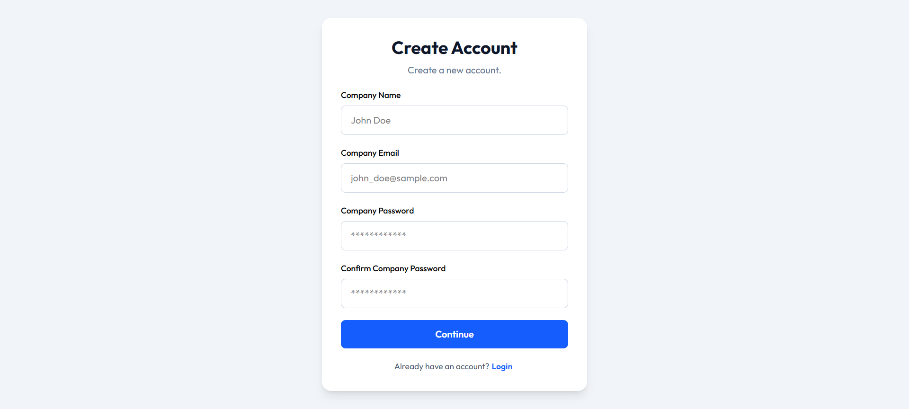

#### View Applications

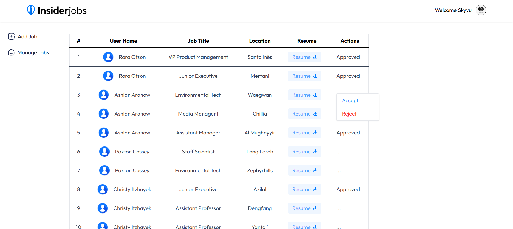

#### Add Job

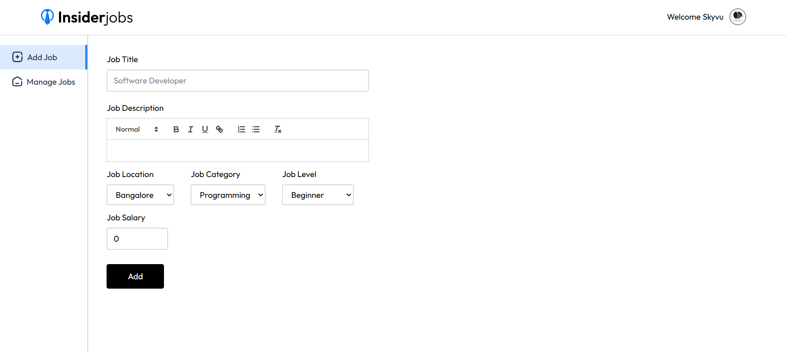

#### Manage Jobs

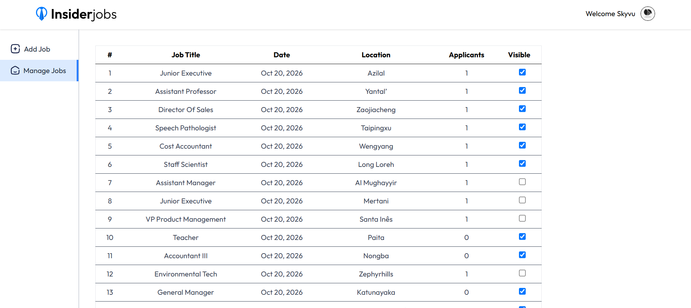
